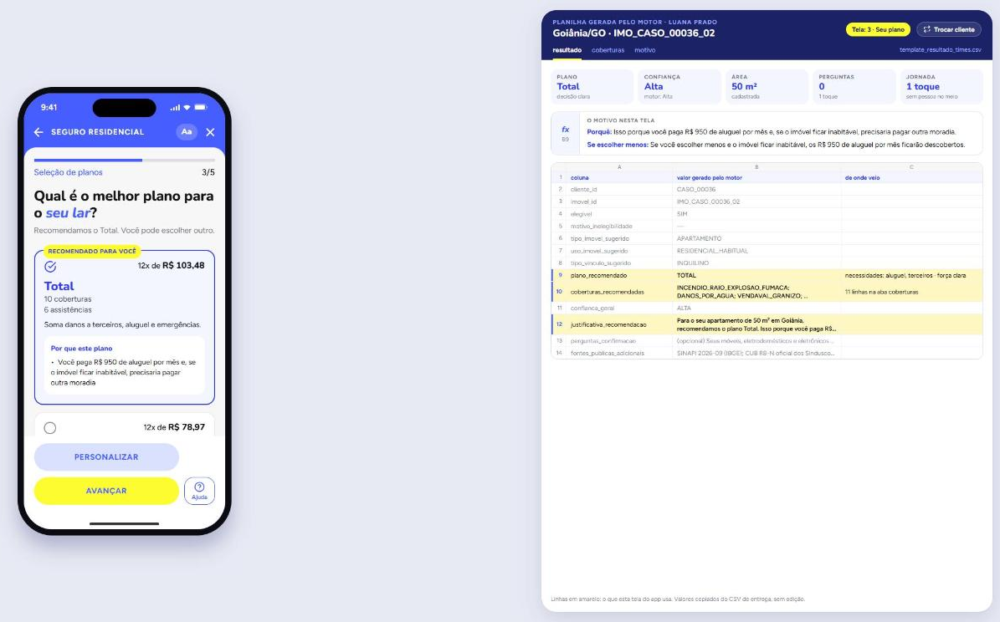

<p align="center">
  
</p>

<h1 align="center">Proteção Inteligente · Seguro Residencial</h1>

<p align="center">
  <b>1º lugar no Datathon Proteção Inteligente</b><br>
  BB Seguros · BB Digital Week 2026
</p>

<p align="center">
  
  
  
  
</p>

<p align="center">
  <a href="https://youtu.be/m5JwMmed0pc"><b>Vídeo do pitch</b></a> ·
  <a href="slides/index.html"><b>Slides</b></a> ·
  <a href="entrega/"><b>Planilhas da entrega</b></a> ·
  <a href="documentos/contexto/00-mapa.md"><b>Linha do tempo</b></a>
</p>

---

Para cada cliente e imóvel, o motor responde à pergunta do desafio: **quanto proteger esta casa e com qual plano?** Ele usa só o que o banco já sabe. Pelo IPTU e pela conta de luz, estima o tamanho do imóvel; pelas compras dos últimos anos, estima os bens. Com isso o cliente responde em média 2,7 perguntas, contra cerca de 20 campos de uma cotação tradicional.

Cada recomendação explica, com os números da própria pessoa, por que aquele plano faz sentido e o que ficaria descoberto com um plano menor. O motor é feito de regras explicáveis, sem machine learning: cada decisão tem uma regra escrita, uma fonte e um teste.

## O app

<table>
  <tr>
    <td align="center"></td>
    <td align="center"></td>
    <td align="center"></td>
    <td align="center"></td>
  </tr>
  <tr>
    <td align="center"><sub><b>Entrada</b><br>o que está em jogo, com os dados do cliente</sub></td>
    <td align="center"><sub><b>Sua casa</b><br>o que o banco já sabe e a confiança</sub></td>
    <td align="center"><sub><b>O que cobre</b><br>situações reais, com e sem seguro</sub></td>
    <td align="center"><sub><b>Seu plano</b><br>a recomendação e o porquê</sub></td>
  </tr>
</table>

O app é um protótipo da jornada dentro do app do BB, feito para a demonstração. Todos os números na tela vêm do motor. No navegador, a planilha que o motor gerou para o cliente aparece ao lado do celular, como na imagem do topo.

## Equipe Varetas

| | |
|---|---|
| Eduardo Vieira Ponce Firmino | Luís Guilherme Lebedeff |
| Matheus Ferreira de Souza | Pedro Ian Guedes Carvalho |
| Vinicius Ferreira Assunção | |

Desafio: **Seguro Residencial**.

## Como funciona

```
dados/desenvolvimento ──► calibrar()  (R$ de IPTU e de energia por m², por município)
                                │
dados/teste_comum ──► processar_caso() para cada cliente-imóvel
   1. inferir tipo, vínculo, uso, área e bens  → cada dado com natureza, fonte e confiança
   2. elegibilidade (guia 9.1)                 → SIM / NAO / SIM + pergunta
   3. plano pelas necessidades                 → aluguel → Total; roubo e vidros → Prático; terceiros → RC
   4. faixa mín/máx de cada cobertura          → SINAPI, CUB, IPCA, FipeZAP, condições gerais
   5. até 3 perguntas, pelo valor da informação
   6. confiança por regra + jornada (1 toque, app com perguntas, gerente só em último caso)
   7. motivo feito para o cliente: casa e cidade, porquê, fato que o diferencia dos vizinhos,
      risco da cidade, o que fica descoberto em reais, confiança com o acerto medido (motor/motivo.py)
                                │
                     ficha (JSON) ──► 2 planilhas · métricas · demo · API
```

A mesma ficha alimenta as duas planilhas, o app do cliente, o painel do gerente e uma API para agentes.

## Como rodar

Python 3.11 (registrado em `.python-version`).

```bash
pip install -r requirements.txt
python -m pytest -q                 # 155 testes
python motor/gerar.py --entrega     # gera, valida e copia as planilhas para entrega/
```

| O quê | Como |
|---|---|
| **App** (Node 22) | Em `app-expo/`: `npm install` e `npx expo start --web`, depois abra `http://localhost:8081` numa janela larga. No celular: Expo Go + `npx expo start`. Para atualizar as fichas depois de mudar o motor: `python motor/gerar.py --entrega` e `npm run dados` |
| **Slides** | Abra `slides/index.html` no navegador (setas para navegar, F para tela cheia, N para as notas) |
| **Demo antiga** | Abra `prototipos/indexprototipo_gerente.html`. Os botões A, B e C mostram os perfis do slide 14 com a ficha real do motor |
| **API** | `pip install -r requirements-api.txt` e `uvicorn api:app --app-dir motor --port 8000`. Documentação em `/docs` |
| **Testes no GitHub** | Rodam sozinhos a cada envio (`.github/workflows/testes.yml`) |

## Onde está cada entrega

| Entregável do guia | Onde está |
|---|---|
| Templates preenchidos (138 casos) | `entrega/template_resultado_times.csv` e `entrega/template_coberturas_times.csv` (versão para Excel: `documentos/planilhas_para_leitura.xlsx`) |
| Códigos | `motor/` (motor em Python), `app-expo/` (app), `tests/` (155 testes) |
| Dependências | `requirements.txt` + `.python-version` (Python 3.11); app: `app-expo/package.json` (Node 22) |
| Dados externos | `motor/externos/` e `motor/externos/FONTES.md` (fonte, data, licença, método, transformação e limitações) |
| Apresentação | [Vídeo do pitch](https://youtu.be/m5JwMmed0pc) · `slides/index.html` |
| Métricas e evidências | `entrega/metricas.json`, `entrega/assertividade.json`, `entrega/casos_contrastantes.json` |

<details>
<summary><b>Arquivos do projeto</b></summary>

| Arquivo | O que faz |
|---|---|
| `motor/motor.py` | Inferências, elegibilidade, plano, coberturas, perguntas, confiança e planilhas |
| `motor/parametros.py` | Todas as premissas numéricas, com a origem escrita ao lado |
| `motor/metricas.py` | Métricas do guia §8 e casos contrastantes |
| `motor/assertividade.py` | Quanto acerta cada cálculo que completa um dado faltante (validação em 5 dobras, comparação com o chute) |
| `motor/templates.py` | Valida as planilhas contra as regras do guia antes de gravar |
| `motor/gerar.py` | Roda tudo de ponta a ponta |
| `motor/api.py` | API de demonstração (ficha e recálculo com as respostas do cliente) |
| `motor/externos/` | Fontes externas salvas + `FONTES.md` |
| `entrega/` | As 2 planilhas, `metricas.json`, `casos_contrastantes.json` e `assertividade.json` |
| `tests/` | Testes automáticos (motor, assertividade, motivo, API e coletor) |
| `app-expo/` | App do cliente e portal do gerente (Expo/React Native) |
| `slides/` | Slides do pitch (HTML) |
| `prototipos/` | Protótipo HTML anterior e `fichas_demo.js` (fichas do motor para os apps) |
| `obsidian/` | Vault do time: regras de negócio, decisões, explicação de cada cálculo e pitch |
| `dados/` | Bases da organização (fictícias): desenvolvimento e Teste Comum |
| `documentos/contexto/` | Um documento curto por etapa (comece pelo `00-mapa.md`) |

</details>

## Resultados

**Os 2 casos da demonstração**

| Cliente | Caso | O que mostra |
|---|---|---|
| Luana · apartamento de 50 m² em Goiânia | `IMO_CASO_00036_02` | Dados completos: plano Total (paga aluguel), confiança alta, **nenhuma pergunta**, contrata em 1 toque |
| Sérgio · casa em Porto Alegre | `IMO_CASO_00015_01` | Área estimada e padrão desconhecido: Essencial **no limite**, confiança média, **2 perguntas**. Se ele responde que os eletrônicos passam de R$ 10 mil, o plano sobe para o Prático na hora |

**Casos contrastantes (slide 14)**

| Perfil | Caso | Plano | Por quê |
|---|---|---|---|
| A · Apartamento urbano | `IMO_CASO_00004_01` | Prático + RC | Bens e eletrônicos comprovados altos; dependentes ou pet pedem a RC adicional |
| B · Casa familiar | `IMO_CASO_00001_01` | Prático + RC | Casa em condomínio com bens altos; a família pede a RC familiar como adicional |
| C · Imóvel de lazer | `IMO_CASO_00010_01` | Essencial + RC | Apartamento de veraneio que fica vazio: o roubo do Prático não cobre residência desocupada |
| Já segurado? | `IMO_CASO_00014_01` | Prático + RC | Provável seguro BB no endereço: vira pergunta obrigatória; se sim, não há nova proposta |

## Métricas (base comum, 138 casos)

| Métrica | Resultado |
|---|---|
| Casos processados / com justificativa / coberturas fixas completas | 100% · 100% · 100% |
| Falhas na execução | 0 |
| Planos | Prático 66 · Total 38 · Essencial 34 |
| Força da recomendação | clara 124 · no limite 14 (recebem a pergunta que decide o plano) |
| Coberturas adicionais | 93 (RC familiar para quem mora em prédio ou condomínio, ou tem dependentes ou pet) |
| Elegibilidade | SIM 138 · 37 com confirmação pendente, 16 deles "provável seguro BB" |
| Confiança | ALTA 17 · MÉDIA 101 · BAIXA 20 (14%) |
| Jornada | 1 toque 63 · app com perguntas 49 · gerente 26 (obra 10, sem app 16) |
| Motivo | 0 genéricos · 100% com fato do próprio cliente e valor em risco · mediana de 127 palavras |
| Perguntas por caso | 2,75 (0,46 obrigatória; as demais só ajustam o valor) |
| Teste de justiça (troca renda e idade) | 0 casos mudam |
| Estabilidade do plano (valores ±5%) | 1 caso muda |
| Estabilidade da confiança (pesos ±20%) | 0 casos mudam |
| Sensibilidade (área +10%) | incêndio +4,1% em média, 0 quedas |
| Regra dos 80% na elegibilidade por faixa de renda | 1,00 |
| Reprodutibilidade | duas rodadas geram arquivos idênticos |
| Tempo | ~0,5 s para os 138 casos |

<details>
<summary><b>Métricas de mercado e validação fora da amostra</b></summary>

| Métrica | Resultado | Como |
|---|---|---|
| 1 toque puro · sem pessoa no meio | 45,7% · 81,2% dos elegíveis | Sem pergunta obrigatória · 1 toque + app com perguntas de sim/não |
| Esforço | 2,7 perguntas × 19,9 campos de uma cotação tradicional (86,4% menos) | 5 dados do imóvel + 6 declarações de elegibilidade + 1 valor por cobertura |
| ITV do incêndio (segurado ÷ valor em risco) | máximo 1,48 · mínimo 0,62 · sugerido ÷ cenário pessimista 0,67 | O valor sugerido evita o mínimo; contra o pior cenário ele cobre 67% |
| Área | erro mediano 14,1% (chute 44,4%); a faixa contém a área real em 81% | Validação cruzada em 5 dobras na base de desenvolvimento |
| Padrão pelo IPTU/m² | intervalo certo em 97,8% dos 182 estreitados | Mesmo método |
| Área × padrão (sem os dois) | faixa 1,76× contendo o real em 88% | Mesmo método |
| Bens sem compras | erro mediano 40,0% só com a região → 22,3% com região + renda | Fora da amostra, 2.578 imóveis |
| Tipo · vínculo · bens (sem gabarito) | termo × complemento concordam em 100% · 0 conflitos aluguel × financiamento | Concordância entre fontes |

Tudo em `entrega/metricas.json`. As planilhas usam os dados externos salvos no repositório; `python motor/externos/coletar.py --ao-vivo` renova as fontes pelas APIs e, de propósito, muda as faixas.

</details>

## Premissas

- **Faixa = importância segurada** (quanto segurar), não valor de sinistro.
- **Casa:** área × custo do m² (mínimo SINAPI/IBGE, máximo CUB oficial) × padrão construtivo. Terreno não entra.
- **Apartamento, casa em condomínio ou financiado:** segundo risco (CG cl. 15.2). A estrutura tem seguro próprio; segura-se 25% a 40% (acabamentos) + bens.
- **Idade não entra em nenhuma decisão.** Dependentes e pet só pedem a RC familiar, nunca mudam valor, risco, canal ou confiança.

<details>
<summary><b>Todas as premissas</b></summary>

- **Bens:** compras de 36 meses e bens vinculados, corrigidos pelo IPCA (Banco Central), até 2,7 × as compras. Sem compras nem bens ligados ao imóvel: média da região combinada com a renda (média geométrica; erro mediano fora da amostra de 40,0% só com a região para 22,3%).
- **Área sem cadastro (67% dos casos):** IPTU^0,6 × energia^0,4 (média geométrica), cada um dividido pelo R$/m² do município. Os pesos foram confirmados por regressão (0,59 e 0,42). Erro mediano fora da amostra de 14,1% (o chute erra 44,4%). A renda não ajuda aqui (correlação 0,01 com a área).
- **Padrão construtivo vazio:** com área cadastrada, o IPTU/m² descarta um extremo (acerta o intervalo em 97,8%). Sem área e sem padrão (64 casos), faixa calibrada de área × padrão: contém o valor real em 88% dos testes, com 1,76× de largura. E a pergunta do acabamento.
- **Plano:** pelas três necessidades do cliente (aluguel em jogo → Total; roubo e vidros → Prático; danos a terceiros → RC familiar), cada uma com a prova e a força ("clara" ou "no limite", com pergunta decisiva). Explicação completa em `obsidian/BB Datathon/16 - Projeto por inteiro/02 - O motor passo a passo.md`.
- **Renda:** na mentoria de 28/10, o Banco do Brasil confirmou que renda não é dado sensível (a LGPD, art. 5º, II, também não a lista). Ela entra num ponto só: os bens de quem não tem compras nem bens ligados ao imóvel, sempre combinada com a média da região, e o cliente lê no motivo que a renda foi usada. Elegibilidade, canal e confiança não usam renda. Desligável em `parametros.RENDA_NOS_BENS_SEM_COMPRAS`.

</details>

## Elegibilidade (guia 9.1)

| Regra | Como o motor trata |
|---|---|
| Situação cadastral tombado, desapropriado ou condenado | `NAO` |
| Endereço que já tem seguro BB | Um imóvel só → `NAO`. Dois imóveis → `SIM` + "qual já tem seguro?" |
| Construção ou reforma | Gasto alto com material de construção → `SIM` + pergunta |
| Parede de material combustível | `SIM` + pergunta sobre madeira pré-fabricada ABNT |
| Comunidade, favela, atividade rural, MEI fora da lista | A base não tem esses dados: confirmação na contratação |

## Limitações

- A base não tem sinistros nem rótulos de plano, então não há acurácia de recomendação a medir. O que tem gabarito (área e padrão cadastrados) é medido fora da amostra em `entrega/assertividade.json`.
- O máximo dos bens (2,7 × as compras, cerca de 8 anos de vida útil) é premissa: não há dado do valor real do que está dentro das casas.
- Favela, atividade rural e MEI não aparecem nos dados e precisam de declaração na contratação.
- O CUB de RJ, PE e CE não foi conferido em fonte oficial. Nessas UFs o máximo é SINAPI × razão CUB/SINAPI das 7 UFs oficiais (≈ 1,14).
- Custos e aluguel são médias do estado ou da capital, não do bairro.
- O catálogo do datathon não tem "instalações e pequenos reparos", que o guia lista no Essencial. Seguimos o catálogo.
- Vendaval, danos por água, RC e despesas emergenciais usam proporções definidas pelo time, sem dado de sinistro para calibrar.
- O risco de território vem da Defesa Civil (Atlas/S2iD) e da ANEEL e aparece só no texto do motivo; o risco de furto segue sem fonte.

## Fontes externas

SINAPI (IBGE, API SIDRA, set/2026), CUB oficial (Sinduscons de SP, DF, GO, BA, MG, RS e PR), IPCA (Banco Central, API SGS 433), FipeZAP Locação (Fipe), Atlas Digital de Desastres / S2iD (Sedec/MIDR, 1991 a 2025), Ranking de Continuidade 2025 da ANEEL e Condições Gerais BB Seguro Residencial v1.4. Detalhes, licença e limitações em `motor/externos/FONTES.md`.

## Privacidade e responsabilidade

- Só dados do pacote, que são fictícios, e fontes públicas.
- Idade e origem da renda não entram em nenhuma regra (teste automático). A renda entra num ponto só, controlado por um parâmetro, e o texto do cliente avisa quando ela foi usada.
- Toda estimativa vira pergunta ou vai para o gerente; nada é contratado sem confirmação.
- Nenhuma credencial ou dado restrito no repositório.

## Uso de IA

Usamos ferramentas de IA como apoio. As regras, os parâmetros, as decisões de produto e os resultados foram decididos, executados e conferidos pela equipe, que entende e defende o código e a solução. O motor não chama nenhum modelo de IA: são regras determinísticas, e a mesma entrada gera sempre a mesma saída, sem enviar dado de cliente a serviço externo.

<details>
<summary><b>Como usamos cada ferramenta</b></summary>

| Para quê | Ferramenta | Como usamos | O que a equipe fez |
|---|---|---|---|
| Entender a proposta | Claude (Anthropic) | Leitura e resumo do guia, das condições gerais e das regras do produto | Conferimos com os documentos oficiais e com a mentoria do BB; as regras ficaram em `obsidian/BB Datathon/Regras de negócio.md` |
| Ideias | Claude | Debate de ideias para a recomendação, o motivo, as perguntas e a jornada | Escolhemos o que entrava e descartamos o resto (registro em `documentos/contexto/`) |
| Motor (Python) | Claude Code | Escrita e revisão de código com testes primeiro, revisão de código e auditorias | Validamos cada regra contra o guia e conferimos os números na base |
| App (Expo) | Claude Code | Telas, painel-planilha da demonstração e correções | Testamos as jornadas no navegador |
| Ilustrações e ícones | ChatGPT | Imagens no estilo do app, a partir de um prompt nosso | Escolhemos, recortamos e revisamos as imagens |
| Fontes externas | Claude | Pesquisa de fontes públicas e conferência das APIs | Testamos cada API; descartamos uma fonte de imprensa que não dava para auditar |
| Slides e pitch | Claude e Codex (OpenAI) | Roteiro, prompt de design e geração de `slides/index.html` | Escolhemos a ordem final, conferimos cada número com `entrega/metricas.json` e apresentamos com as nossas palavras |

</details>

## Relato

Os caminhos testados e descartados estão em `documentos/contexto/`, na seção "Decisões e o que descartamos" de cada etapa. Alguns exemplos: a confiança por corte numa nota (instável), levar ao Total qualquer cliente com criança ou pet (o Total ia a 65% dos casos) e o CUB de agregador (fonte não oficial).
